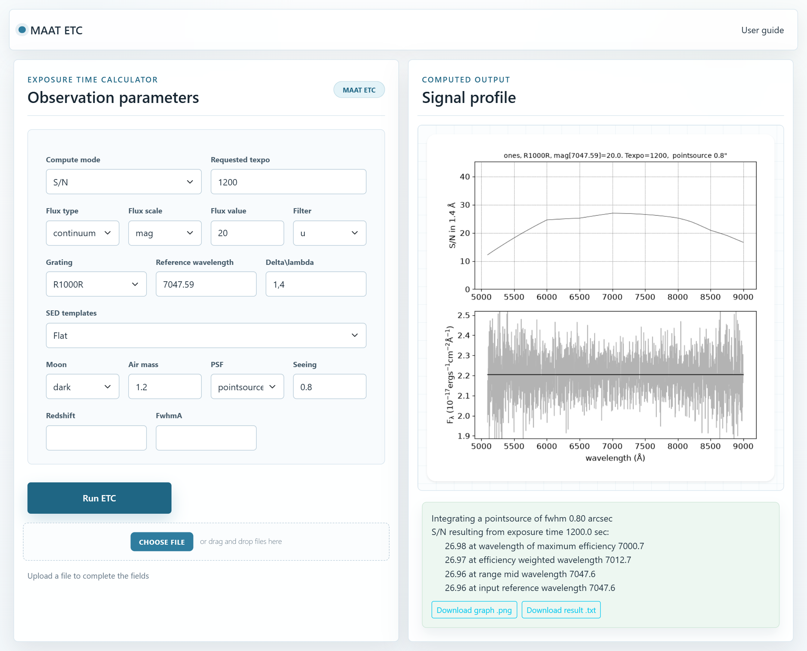
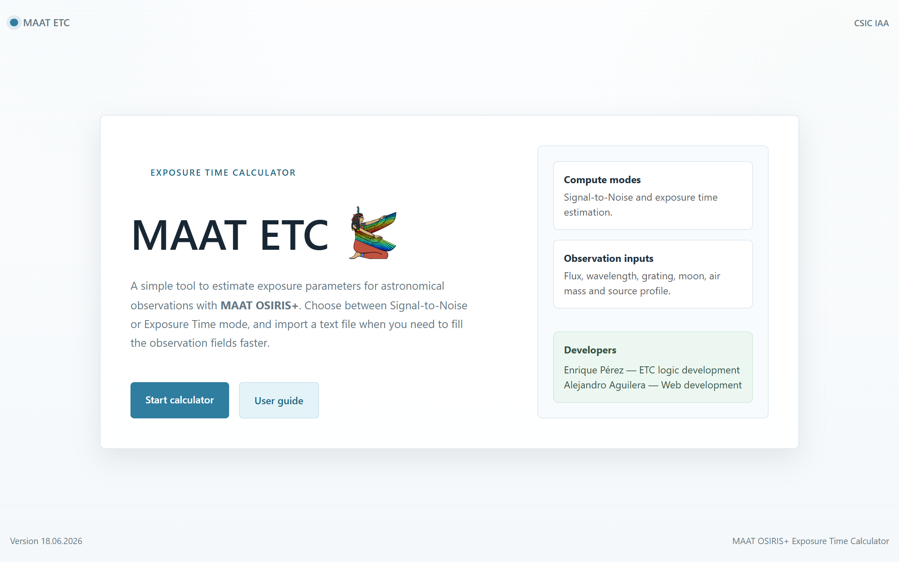
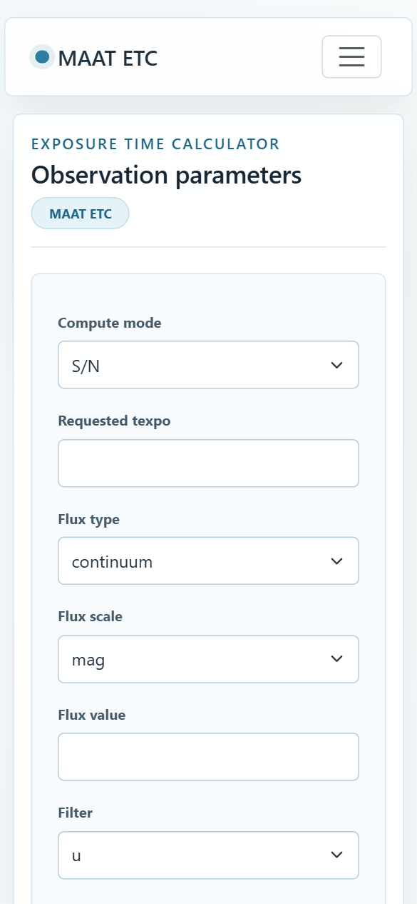
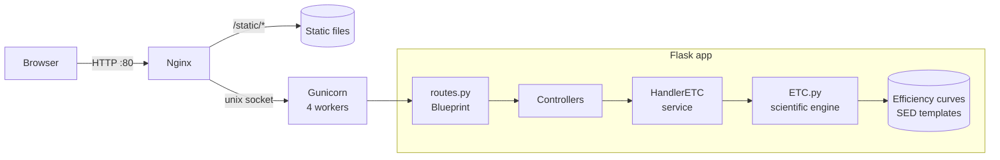
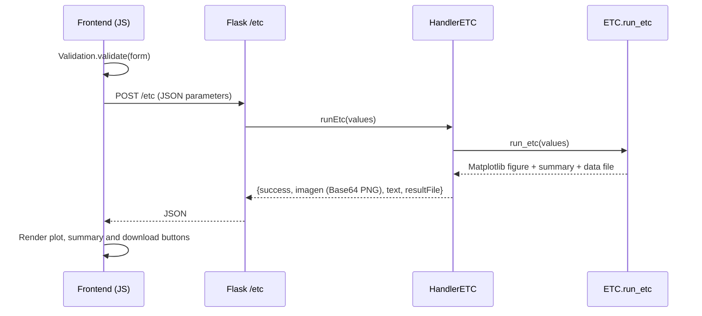

<div align="center">


# MAAT ETC

**A web-based Exposure Time Calculator for the MAAT integral-field unit on OSIRIS+ at the Gran Telescopio Canarias (GTC).**


</div>

---

## Summary

**MAAT ETC** lets astronomers plan observations: given a target and observing conditions, it computes either the **signal-to-noise ratio (S/N)** reached with a given exposure time, or the **exposure time** needed to reach a given S/N, across the full wavelength range of the selected grating.

The scientific core was originally a **desktop Python script with a PySimpleGUI interface**, used internally by astronomers. This project turned it into a **production web application**:

- Refactored the calculation engine into a stateless backend service, removing every local-GUI dependency while keeping the physics untouched.
- Built a **REST API with Flask** (Blueprints + Controller/Service layers) that returns the plot as a Base64 PNG, a text summary and a downloadable data file.
- Built a **modular vanilla-JavaScript frontend** (ES modules) with declarative client-side validation, dynamic form fields, drag-and-drop file import and responsive design.
- Deployed it on **Linux with Nginx → Gunicorn → Flask**, managed by **systemd**, with a reproducible **Vagrant** environment.

The project was developed during an internship at the **Instituto de Astrofísica de Andalucía (IAA-CSIC)**. The production instance runs on the institute's internal network.

---

## Table of contents

- [Screenshots](#screenshots)
- [Features](#features)
- [Tech stack](#tech-stack)
- [Architecture](#architecture)
- [Project structure](#project-structure)
- [Getting started](#getting-started)
  - [1. Run locally](#1-run-locally-python-virtualenv)
  - [2. Run in a Vagrant VM](#2-run-in-a-vagrant-vm)
  - [3. Deploy to production](#3-deploy-to-production-nginx--gunicorn--systemd)
- [Configuration](#configuration)
- [REST API](#rest-api)
- [Parameter file format](#parameter-file-format)
- [Scientific model](#scientific-model)
- [Engineering decisions](#engineering-decisions)
- [Development workflow](#development-workflow)
- [Roadmap](#roadmap)
- [Credits and data sources](#credits-and-data-sources)
- [License](#license)
- [Author](#author)

---

## Screenshots

| Calculator with result |
| :---: |
|  |

| Home page | User guide | Mobile |
| :---: | :---: | :---: |
|  |  |  |

---

## Features

**Calculation**
- Two compute modes: **S/N from exposure time** and **exposure time from S/N**.
- 11 OSIRIS+ gratings (R300B … R2500I) with real efficiency curves.
- Continuum and emission-line sources, point sources (seeing-limited PSF) and extended sources.
- Sky background by moon phase (dark / grey / bright) and atmospheric extinction by air mass (La Palma).
- SED templates: flat, Pickles stellar spectra, black body of any temperature, or a **user-uploaded SED file**. Redshift support.

**User experience**
- Results shown as a two-panel plot (S/N or exposure time, and simulated noisy spectrum) plus a text summary at key wavelengths.
- Download the plot as **PNG** and the full computed spectrum as **TXT**.
- **Import all parameters from a `.txt` file** by drag-and-drop or file picker ([example](files/MAATETC/app/static/etc_example.txt)).
- Real-time, per-field validation with accessible error messages (`aria-invalid`, `aria-describedby`).
- Smart defaults: choosing a grating fills in its dispersion and the central reference wavelength, and validates the wavelength against the grating's range.
- Contextual fields: seeing vs. area by source type, temperature input for black body, file drop zone for custom SEDs.
- Responsive layout (Bootstrap 5) and a built-in user guide.

---

## Tech stack

| Layer | Technologies |
| --- | --- |
| Scientific engine | Python 3, NumPy, SciPy (interpolation), Astropy (units, black-body model), Matplotlib (Agg backend) |
| Backend | Flask 3 (application factory, Blueprints), Jinja2 templates |
| Frontend | HTML5, CSS3, Bootstrap 5, vanilla JavaScript (ES modules), Fetch API, FileReader API |
| Serving | Gunicorn (WSGI, 4 workers, Unix socket), Nginx (reverse proxy and static files) |
| Infrastructure | Debian 11, systemd, Vagrant + VirtualBox |
| Tooling | Git with Conventional Commits, feature branches and pull requests |

---

## Architecture



**Request flow for a calculation**



**Backend layers**

| Layer | File | Responsibility |
| --- | --- | --- |
| App factory | [`app/__init__.py`](files/MAATETC/app/__init__.py) | Creates the Flask app and registers the Blueprint |
| Routes | [`app/routes/routes.py`](files/MAATETC/app/routes/routes.py) | Maps URLs to controllers |
| Controllers | [`app/controllers/`](files/MAATETC/app/controllers) | Render pages and serialise JSON responses |
| Service | [`app/services/handlerETC.py`](files/MAATETC/app/services/handlerETC.py) | Calls the engine, encodes the figure, handles errors |
| Engine | [`app/services/etc/ETC.py`](files/MAATETC/app/services/etc/ETC.py) | Physics: throughput, sky, extinction, PSF, S/N and exposure time |

**Frontend modules** ([`app/static/js/`](files/MAATETC/app/static/js))

| Module | Responsibility |
| --- | --- |
| `index.js` | Entry point; wires DOM events to the modules |
| `modules/validation.js` + `json/validationJson.js` | Rule-based validation engine (rules declared as data with `appliesTo` / `validate`) |
| `modules/formatData.js` | Builds the request payload from the form |
| `modules/requestHandler.js` | `fetch` calls to `/etc` and `/gratings`, error handling |
| `modules/uiController.js` | Renders results, tooltips, dynamic SED fields |
| `modules/textLecture.js` | Parses uploaded parameter files and fills the form |
| `json/componentesForm.js`, `json/componentesGraph.js` | Declarative UI component factories |

---

## Project structure

```text
MAATETC/
├── Vagrantfile                 # Debian 11 VM, provisions the full stack
├── LICENSE
├── docs/screenshots/           # Images used in this README
└── files/
    ├── conf/
    │   ├── deploy.sh           # Idempotent deployment script (Nginx + Gunicorn + systemd)
    │   ├── flask_app.service   # systemd unit for Gunicorn
    │   └── MAATETC.conf        # Nginx server block
    └── MAATETC/                # The Flask application
        ├── wsgi.py             # WSGI entry point (wsgi:app)
        ├── requirements.txt
        ├── .env                # FLASK_APP / FLASK_ENV
        └── app/
            ├── __init__.py     # Application factory
            ├── routes/
            ├── controllers/
            ├── services/
            │   ├── handlerETC.py
            │   └── etc/
            │       ├── ETC.py          # Scientific engine
            │       ├── efficiency/     # Grating and instrument throughput curves
            │       └── seds/           # Spectral energy distribution templates
            ├── static/         # CSS, JS modules, images, example parameter file
            └── templates/      # index.html, compute.html, guide.html
```

---

## Getting started

### Prerequisites

- **Python 3.10+** (tested with 3.11)
- Git
- For the VM option: [Vagrant](https://developer.hashicorp.com/vagrant) and [VirtualBox](https://www.virtualbox.org/)

### 1. Run locally (Python virtualenv)

```bash
git clone https://github.com/alexbaaaa/MAATETC.git
cd MAATETC/files/MAATETC

python -m venv .venv
source .venv/bin/activate          # Windows: .venv\Scripts\activate
pip install -r requirements.txt

flask --app wsgi run --debug
```

Open <http://127.0.0.1:5000>.

To try the production server locally (Linux/macOS):

```bash
gunicorn --workers 4 --bind 127.0.0.1:8000 wsgi:app
```

### 2. Run in a Vagrant VM

The [`Vagrantfile`](Vagrantfile) creates a Debian 11 VM and runs [`deploy.sh`](files/conf/deploy.sh), which installs the full production stack inside it.

```bash
vagrant up
```

| Access | URL |
| --- | --- |
| Nginx (production stack) | <http://localhost:8080> or <http://192.168.56.9> |
| Flask dev server (optional) | `vagrant ssh`, then `cd /var/www/MAATETC && venv/bin/flask run --host 0.0.0.0`, open <http://localhost:5000> |

After changing code on the host, sync it to the VM and restart the service:

```bash
vagrant ssh -c "sudo rsync -a --exclude venv/ /vagrant/files/MAATETC/ /var/www/MAATETC/ && sudo systemctl restart flask_app"
```

### 3. Deploy to production (Nginx + Gunicorn + systemd)

On a Debian/Ubuntu server:

```bash
git clone https://github.com/alexbaaaa/MAATETC.git /opt/MAATETC
sudo APP_USER=www-data /opt/MAATETC/files/conf/deploy.sh /opt/MAATETC
```

The script:

1. Installs `python3-venv`, `nginx` and `rsync`.
2. Copies the app to `/var/www/MAATETC` and creates a virtualenv with `requirements.txt`.
3. Installs [`flask_app.service`](files/conf/flask_app.service): Gunicorn with 4 workers on the Unix socket `/var/www/MAATETC/app.sock`, restarted automatically on failure.
4. Installs [`MAATETC.conf`](files/conf/MAATETC.conf): Nginx serves `/static/` directly and proxies everything else to the socket.

Edit `server_name` in `MAATETC.conf` for your domain. For HTTPS, add a certificate with [Certbot](https://certbot.eff.org/): `sudo certbot --nginx -d your.domain`.

**Useful operations**

```bash
sudo systemctl status flask_app          # service status
sudo journalctl -u flask_app -f          # application logs
sudo tail -f /var/log/nginx/app.error.log
sudo systemctl restart flask_app         # after deploying new code
```

---

## Configuration

| Variable | File | Default | Description |
| --- | --- | --- | --- |
| `FLASK_APP` | `.env` | `wsgi.py` | Entry point used by `flask run` |
| `FLASK_ENV` | `.env` | `production` | Environment name |
| `APP_USER` | `deploy.sh` (env) | `vagrant` | Linux user that runs Gunicorn |
| `--workers` | `flask_app.service` | `4` | Gunicorn worker processes (CPU-bound plots: about one per core) |

The application stores no state and needs no database or secrets.

---

## REST API

### `GET /gratings`

Returns the available gratings with their wavelength range (Å) and dispersion (Å/pixel).

```json
[
  { " name": "R1000R", "grating": [5093.89, 9000.69], "dispersion": 1.4 }
]
```

| Grating | Range (Å) | Dispersion (Å/px) | | Grating | Range (Å) | Dispersion (Å/px) |
| --- | --- | --- | --- | --- | --- | --- |
| R300B | 4007 – 8994 | 2.60 | | R1000R | 5094 – 9001 | 1.40 |
| R300R | 5005 – 8996 | 4.02 | | R2000B | 3954 – 5691 | 0.46 |
| R500B | 4000 – 7867 | 1.87 | | R2500U | 3700 – 4520 | 0.33 |
| R500R | 5002 – 9001 | 2.58 | | R2500V | 4431 – 6050 | 0.44 |
| R1000B | 3600 – 7868 | 1.13 | | R2500R | 5577 – 7681 | 1.56 |
| | | | | R2500I | 7401 – 9799 | 1.73 |

### `POST /etc`

Runs a calculation. Body (`application/json`, all values as strings):

| Field | Required | Values / unit | Description |
| --- | --- | --- | --- |
| `compute` | yes | `SN` \| `texpo` | Compute S/N from time, or time from S/N |
| `texpoSN` | yes | s or S/N | Exposure time (mode `SN`) or target S/N (mode `texpo`) |
| `fluxtype` | yes | `continuum` \| `emline` | Source type |
| `fluxval` | yes | AB mag, or erg s⁻¹ cm⁻² (Å⁻¹) | Values > 0.1 are read as AB magnitudes, ≤ 0.1 as physical flux |
| `refwv` | yes | Å | Reference wavelength (must be inside the grating range) |
| `grating` | yes | see table above | |
| `sedtemplate` | yes | `ones`, `pickles_A0V`, `blackbody 5778`, `custom`, or any file name in `seds/` (e.g. `dM20`, `orion`, `pn`) | Spectral template |
| `customSedContent` | if `custom` | text, 2 columns (Å, flux) | Content of the uploaded SED |
| `moon` | yes | `dark` \| `grey` \| `bright` | Sky brightness |
| `psf` | yes | `pointsource` \| `extended` | Source geometry |
| `seeing` | if point source | arcsec | Seeing FWHM |
| `area` | if extended | arcsec | Side of the integration box |
| `airmass` | no (1) | | |
| `redz` | no (0) | | Redshift applied to the SED |
| `breadth` | no (0) | Å | Spectral bin width (defaults to the dispersion) |
| `fwhmA` | no (0) | Å | Emission-line width |
| `toverhd` | no (300) | s | Overhead time (long-slit comparison only) |

Example:

```bash
curl -s -X POST http://127.0.0.1:5000/etc \
  -H "Content-Type: application/json" \
  -d '{"compute":"SN","texpoSN":"1200","fluxtype":"continuum","fluxval":"20",
       "refwv":"6500","grating":"R1000R","sedtemplate":"ones","moon":"dark",
       "airmass":"1.2","psf":"pointsource","seeing":"0.8"}'
```

Response:

```json
{
  "success": true,
  "imagen": "<Base64-encoded PNG>",
  "text": "Integrating a pointsource of fwhm 0.80 arcsec\nS/N resulting from exposure time 1200.0 sec:\n    30.61 at wavelength of maximum efficiency 7000.7\n ...",
  "resultFile": {
    "filename": "SN_20261113135324.txt",
    "content": "# <parameters>\n<wavelength> <flux> <noisy flux> <S/N or Texpo>\n..."
  }
}
```

If the parameters cannot produce a valid result, the API returns `"success": false` with an explanatory `text` instead of an HTTP 500, and the stack trace goes to the server log.

---

## Parameter file format

The form can be filled from a plain-text file. Each line is `field = value #`, using the form field IDs:

```text
compute = SN #
texpoSN = 1200 #
fluxtype = continuum #
fluxval = 1.0 #
wvinflux = 6500 #
grating = R1000R #
sedtemplate = ones #
moon = dark #
airmass = 1.2 #
psf = pointsource #
seeing = 0.8 #
```

A complete example is served at [`/static/etc_example.txt`](files/MAATETC/app/static/etc_example.txt). Unknown fields or malformed lines show a warning in the UI.

---

## Scientific model

For every wavelength bin λ of the selected grating, the engine computes the detected object and sky counts per second:

$$S_{obj}(\lambda) = F_\lambda \cdot \frac{\lambda}{hc} \cdot \eta(\lambda) \cdot e(\lambda, X) \cdot A_{tel} \cdot \Delta\lambda \cdot f_{PSF}$$

where η is the total throughput (grating × MAAT IFU × detector QE), *e* the atmospheric extinction at air mass *X*, *A*<sub>tel</sub> = 73 m² the GTC collecting area, and *f*<sub>PSF</sub> the fraction of light inside the aperture (computed by integrating a 2-D Gaussian/Moffat seeing profile).

Then:

$$\frac{S}{N} = \frac{S_{obj}\,t}{\sqrt{S_{obj}\,t + S_{sky}\,t + D\,t + RON^2\,n_{pix}}}$$

and, in exposure-time mode, the same equation is solved for *t*. The output also includes a simulated noisy spectrum drawn from that S/N.

The physics was kept identical to the original script; the refactor only changed structure, I/O and robustness (see [`maatetc_gui_refactor.md`](files/MAATETC/app/services/etc/maatetc_gui_refactor.md)).

---

## Engineering decisions

- **Desktop → web refactor without touching the science.** GUI code and intermediate file writes were removed, paths are resolved from `__file__` instead of the working directory, and the public `run_etc` signature was kept so the service layer stays decoupled.
- **Headless plotting.** Matplotlib uses the `Agg` backend and an object-oriented `Figure` per request (not the global `pyplot` state), so it is safe with several Gunicorn workers.
- **Stateless API.** The plot travels as Base64 inside the JSON response and the result file is built in memory, so nothing is written to disk on the server.
- **Graceful errors.** Engine exceptions are logged server-side and turned into a user-friendly message; out-of-range wavelengths return an explanatory figure instead of failing.
- **Declarative validation.** Frontend validation rules are data (`appliesTo` + `validate`), so new rules are added without touching the engine; the backend still validates and handles invalid input.
- **No build step.** Native ES modules keep the frontend dependency-free and easy to deploy.
- **Production serving.** Nginx serves static assets and buffers clients; Gunicorn talks over a Unix socket; systemd restarts the service on failure.

---

## Development workflow

- **Branching:** `main` (stable), `develop`, and `feature/*` / topic branches merged through pull requests.
- **Commits:** [Conventional Commits](https://www.conventionalcommits.org/) (`feat:`, `fix:`, `style:`, `refactor:`, `docs:`, `chore:`). Use the template with `git config commit.template .gitmessage`.

---

## Roadmap

- [ ] Use the new **flux unit** (`mag` / `Flambda`) and **photometric filter** (u, g, r, i, z) fields in the backend calculation (UI is ready).
- [ ] Unit tests for the engine and API (pytest) and end-to-end tests for the UI.
- [ ] CI pipeline (GitHub Actions) with linting and tests.
- [ ] Server-side validation of the request schema with clear 4xx responses.
- [ ] Docker image as an alternative deployment method.
- [ ] Expose the full SED library (M dwarfs, T dwarfs, nebulae, kilonovae) in the UI.

---

## Credits and data sources

- Developed during an internship at the **Instituto de Astrofísica de Andalucía (IAA-CSIC)**. The scientific calculation logic was provided by the institute; the web application, API, frontend and deployment are the author's work.
- Instrument: **MAAT** (Mirror-slicer Array for Astronomical Transients), an IFU for **OSIRIS+** at the **Gran Telescopio Canarias**.
- Stellar templates: Pickles (1998) spectral library. Nebular templates (Orion, planetary nebula): [STScI ETC reference spectra](https://etc.stsci.edu/etcstatic/users_guide/1_ref_2_spectral_distribution.html).
- La Palma extinction and sky brightness: ING Observers' Guide.

---

## License

Distributed under the MIT License. See [`LICENSE`](LICENSE).

---

## Author

**Alejandro Aguilera López** — web development, API and deployment

[](https://github.com/alexbaaaa)
